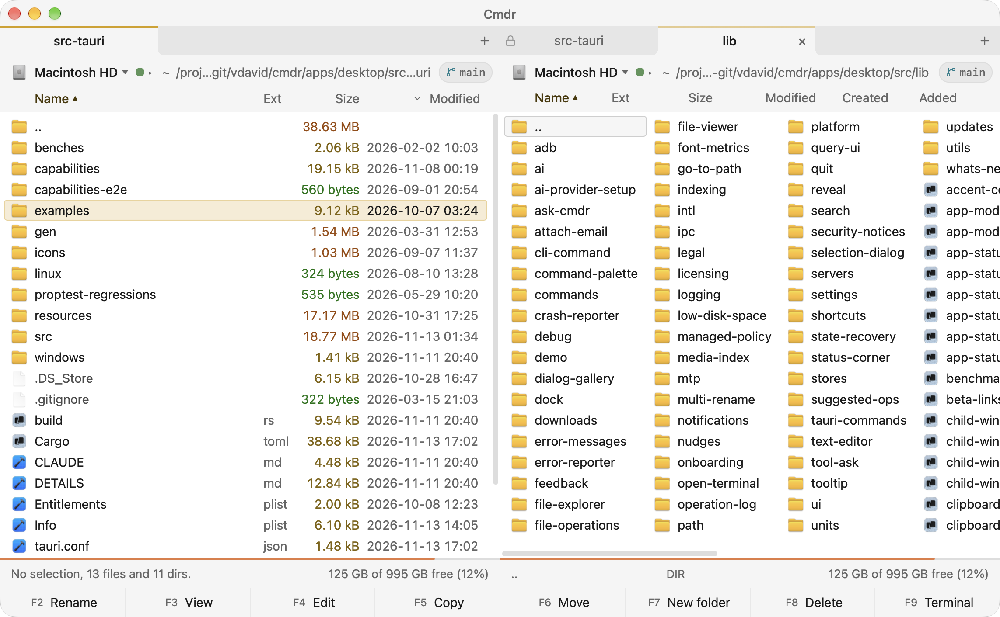

# Cmdr


[](https://scorecard.dev/viewer/?uri=github.com/vdavid/cmdr)

An extremely fast, keyboard-driven two-pane file manager for macOS, written in Rust. Source-available, free for personal
use. With fully optional, privacy-first AI features.

Cmdr is for folks who love a rock-solid, keyboard-driven, two-pane file manager with a modern UI in 2026. Like Total
Commander, but on macOS.

Give it a try: [download for macOS](https://getcmdr.com), or install with Homebrew:

```bash
brew install --cask vdavid/tap/cmdr
```

**Note:** If you'd love a nice short `brew install --cask cmdr`, **star** this repo! Once it hits 225 stars, Homebrew
lets it into its main tap.

<picture>
  <source media="(prefers-color-scheme: dark)" srcset="brand/screenshots/app-main-dark.webp" />
  
</picture>

## Overview

I (David, the dev) loved Total Commander on Windows, used it for 20+ years. Then I switched to macOS, and my biggest
pain point about the OS was a fast, rock-solid, and pleasant file manager. Cmdr intends to fix this.

Then there is AI. With LLMs, some really cool features became possible that never were. I'm experimenting with adding
these features gradually. But the intention is that AI features remain fully **optional**. With AI features off, you've
got a Total Commander-like experience. With it, you get natural-language search and smart selection, with smart renaming
and (human-approved!) auto-organization coming soon. AI features are off by default, and both local and cloud AI are
opt-in, so no files or other data leave your Mac unless you choose to.

Core features:

- **Two-pane layout**: see two folders side by side.
- **Keyboard-first**: do anything without touching your mouse, using your familiar shortcuts.
- **Blazing fast file operations**: copy, move, rename, and delete with a few keystrokes.
- **Optional, privacy-first AI**: search and select with natural language, all on your Mac.
- **Easy on the eyes**: real dark and light modes, and every text color is verified against both WCAG 2.2 AA and APCA,
  the modern perceptual contrast method, so nothing falls below APCA Lc 45.

## Installation

Download it from [getcmdr.com](https://getcmdr.com), or install with Homebrew:

```bash
brew install --cask vdavid/tap/cmdr
```

Naming the cask in full is your okay for Homebrew to tap Cmdr's third-party tap and trust that one cask. A star, watch,
or fork on [the repo](https://github.com/vdavid/cmdr) helps Cmdr reach Homebrew's notability bar (225 stars), which
unlocks a tap-free `brew install --cask cmdr`.

Windows and Linux users: sorry, you'll need to wait. The Rust+Tauri stack allows for cross-platform deployment, but the
app uses OS-specific features by nature, so I've only had time to write and test it on macOS for now.

## Usage

Launch Cmdr and start navigating:

| Key     | Action               |
| ------- | -------------------- |
| `Tab`   | Switch between panes |
| `↑` `↓` | Navigate files       |
| `Enter` | Open file/folder     |
| `F5`    | Copy                 |
| `F6`    | Move                 |
| `F7`    | Create folder        |
| `F8`    | Delete               |

## Tech stack

Cmdr is built with **Rust** and **Tauri** for the backend, and **Svelte** with **TypeScript** for the frontend. This
gives it native performance with a modern, responsive UI.

## License

Cmdr is **source-available** under the [Business Source License 1.1](LICENSE).

### Free for personal use

Use Cmdr for free on any number of machines for personal, non-commercial projects. No nags, no trial timers, no
restrictions.

### Commercial use

For work projects, you'll need a license: **$59, paid once**, per person, on as many of your own machines as you like.
It includes one year of updates. After that year the version you have keeps working forever, and $39/year keeps new
versions coming if you want them.

Buying for an organization? Email [sales@getcmdr.com](mailto:sales@getcmdr.com) and you'll get a quote back.

Purchase at [getcmdr.com/pricing](https://getcmdr.com/pricing).

### Source code

The source becomes [AGPL-3.0](https://www.gnu.org/licenses/agpl-3.0.html) after 3 years (rolling per release). Until
then, you can view, modify, and learn from the code, but not use it commercially without a license.

---

## Contributing

Contributions are welcome! Report issues and feature requests in the
[issue tracker](https://github.com/vdavid/cmdr/issues).

By submitting a contribution, you agree to license your contribution under the same terms as the project (BSL 1.1,
converting to AGPL-3.0) and grant the project owner the right to use your contribution under any commercial license
offered for this project.

Happy browsing!

David
